  

  
  
  
   
  
  

### ▶ 01. PLAYER

Full-stack engineer with about 3 years of web development in Japan.
I've built a security token platform for a securities firm (React, NestJS, PostgreSQL on AWS)
and a logistics system (Java Spring Boot, Vue.js, MySQL), owning features from design docs
through testing and release. Now studying IT in English in Auckland.

> 日本・ニュージーランドでフルスタックエンジニアとして働ける機会を探しています（2027年5月以降）。

### ▶ 02. CURRENT QUEST

- 🎓 Graduate Diploma in Information Technology, Auckland Institute of Studies (until May 2027)
- 🔍 Looking for full-stack roles in Japan or New Zealand
- 🎮 Building [Pixel Quest](https://github.com/shun0619/pixel-quest-portfolio), my portfolio as a retro RPG

### ▶ 03. ACTIVITY

<picture>
  <source media="(prefers-color-scheme: dark)" srcset="https://raw.githubusercontent.com/shun0619/shun0619/output/github-snake-dark.svg" />
  
</picture>

### ▶ 04. MOVES

**FRONTEND** · TypeScript, React, Vue.js

**BACKEND** · Java / Spring Boot, NestJS, MySQL, PostgreSQL

**INFRA & QUALITY** · AWS (ECS/ECR), Docker, Linux, Jest, JUnit

### ▶ 05. HOW I PLAY

- **Specs and tests move together.** When a spec changes, the test changes in the same commit.
- **One owner, design to release.** I'm comfortable taking a feature from design docs to production.
- **Write it down once.** Design notes live in one place and stay current.
- **Learn the next stack fast.** Vue.js → React, MySQL → PostgreSQL / Prisma, Java → TypeScript backends.

### ▶ 06. BADGES

- Oracle Certified Java Programmer, Silver SE 17 (2025)
- TOEIC Listening & Reading 860 (2023)
- Japanese (native) · English (business)

### ▶ 07. TEAM UP

- 💼 [LinkedIn](https://www.linkedin.com/in/shun-miyashita-0ab01829b)
- 🎮 [Portfolio](https://pixel-quest-portfolio-blush.vercel.app/)
